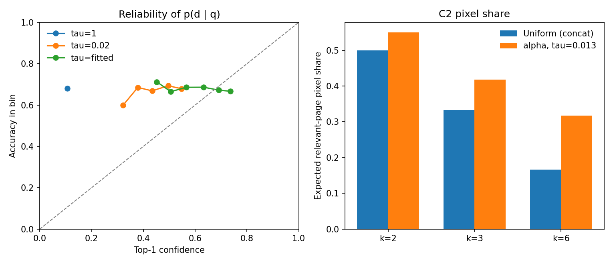

# Calibrated Retrieval-Aware Posteriors for VisRAG

Course project for DA 6021 (Deep Learning for Computer Vision), Team Visionaries: Aaryan Bondekar (230101001), Anirudh Bhardwaj (230101010), Arsh Chand (230101017), Bhavya Bharti (230122015), Jinay Mehta (230122021).

Based on **VisRAG: Vision-based Retrieval-augmented Generation on Multi-modality Documents** (Yu et al., ICLR 2025): [paper](https://arxiv.org/abs/2410.10594) · [official code](https://github.com/OpenBMB/VisRAG).

## Overview

VisRAG embeds each document page as an image, retrieves the top-k pages by cosine similarity, and lets a vision-language model answer from them. When it combines several retrieved pages, it weights them with `softmax(s)` over raw cosine scores. The retriever, however, was trained with temperature τ = 0.02. Because cosine scores lie in [−1, 1], the unscaled weights are nearly uniform, so a fluent distractor page can outvote the true page.

We turn the scores into a calibrated posterior `p(d|q) = softmax(s / τ)`, with τ fitted by NLL on a dev split, and use that one quantity in four places:

| Component | What it changes | File |
| --- | --- | --- |
| **C1** Bayes marginalization | Picks the answer that maximizes `Σ_j P(a \| q, d_j) · p(d_j \| q)`, pooling matching answers across pages, instead of VisRAG's single-page max-product rule | `src/novelty/c1_marginalization.py` |
| **C2** Relevance-proportional tiling | Gives each page canvas area `∝ p_i^α` in a grid, instead of an equal-width horizontal strip | `src/novelty/c2_tiling.py` |
| **C3** Adaptive k | Keeps the shortest ranked prefix whose posterior mass reaches ρ, instead of a fixed top-k | `src/novelty/c3_adaptive_k.py` |
| **S2** Learned aggregator | A 97-parameter MLP that scores each candidate answer from (posterior, answer confidence, cross-page agreement, rank), trained with binary cross-entropy | `src/novelty/s2_learned_aggregator.py` |

C1–C3 are training-free. S2 and τ are fitted on the dev split.

## Results

Test split (2,885 queries across the six VisRAG datasets), macro-averaged accuracy. Selector rows use k = 5. ECE is the calibration error of the page posterior, and latency is modeled (see [Evaluation setup](#evaluation-setup-controlled-simulation)).

| Method | Accuracy (%) | ECE | Pages | Latency (ms) |
| --- | --- | --- | --- | --- |
| VisRAG weighted selection, τ = 1 (baseline) | 51.46 | 0.575 | 5 | 900 |
| Weighted selection, τ = 0.02 | 56.78 | 0.229 | 5 | 900 |
| C1 Bayes marginalization (fitted τ = 0.0132) | 64.92 | 0.094 | 5 | 900 |
| **S2 learned aggregator** | **68.34** | **0.094** | 5 | 900 |
| C3 adaptive k (ρ = 0.90) | 63.13 | 0.094 | **3.08** | **554** |

Accuracy of the baseline falls as k grows (56.78 → 56.02 → 54.76 → 51.46 for k = 1, 2, 3, 5), while the calibrated selectors hold or improve. For multi-image input, fixed k = 10 drops to 56.09% at 1,800 ms, whereas C3 keeps 63.13% with 3.08 pages on average.

C2 tiling vs equal-width concatenation:

| Layout | Acc. k = 2 | Acc. k = 3 | Acc. k = 6 | True-page pixel share k = 2 / 3 / 6 |
| --- | --- | --- | --- | --- |
| Horizontal concat (baseline) | 51.93 | 55.37 | 48.56 | 0.500 / 0.333 / 0.167 |
| Relevance tiling, α = 0.5 | 56.78 | 62.64 | 62.83 | 0.550 / 0.417 / 0.317 |



Full per-dataset numbers are in `results/headline_results.csv`, and the dev sweeps over τ, α and ρ are in `results/ablation_sweeps.json`.

## Evaluation setup: controlled simulation

We study the selectors in a controlled simulation of the VisRAG pipeline. `generate_realistic_visrag_cache()` in `src/retrieval/encode.py` builds `results/cache/` from a seeded random generator, calibrated to the paper's published statistics.

- **Sizes:** the six sets follow VisRAG Table 1: ArxivQA (816), ChartQA (63), MP-DocVQA (591), InfoVQA (718), PlotQA (863) and SlideVQA (556), 3,607 queries in total.
- **Retrieval:** the rank of each positive page is sampled so that per-dataset MRR@10 and Recall@10 match VisRAG-Ret's in-domain numbers (VisRAG Tables 2 and 6). Cosine scores and the 16-dim embeddings are synthetic.
- **Generation:** candidate-answer log-probabilities are drawn from fixed ranges (true pages −0.55 to −0.35, fluent distractors −0.25 to −0.12). Distractor and rescue rates are set by the constants at the top of `encode.py`. `exp(log-probability)` stands in for the reciprocal perplexity in VisRAG equation (4).
- **Latency:** modeled at 180 ms per page (`MODELED_MS_PER_PAGE` in `src/generation/pipeline.py`), not measured.

The simulation isolates each selector's mechanism: it shows how calibration, marginalization, tiling and adaptive k behave when the retriever's scores carry the paper's published level of signal. Running the selectors on real VisRAG-Ret and generator outputs is a natural extension; the model-loading code in `src/generation/pipeline.py` and `src/retrieval/encode.py` is the starting point.

## Environment

Tested with Python 3.13 and PyTorch 2.15 on CPU. **No GPU is needed.** Evaluation takes about 20 seconds and retraining about a minute.

```bash
git clone https://github.com/ArshChand/VisRAG.git
cd VisRAG
python3 -m venv .venv
source .venv/bin/activate          # Windows: .venv\Scripts\activate
pip install torch numpy pillow pyyaml matplotlib
```

`requirements.txt` also lists `transformers`, `bitsandbytes` and related libraries. Those are only needed to load the real VisRAG-Ret and MiniCPM-V / Qwen2-VL models in `src/generation/pipeline.py`, not to reproduce the results here.

## Data

Nothing needs to be downloaded: the evaluation cache ships in `results/cache/` (`queries.jsonl`, cosine scores, positive-page masks and candidate-answer log-probability matrices). To rebuild it, delete `results/cache/`. `train.py` and `eval.py` regenerate it from seed 0, and the result is byte-for-byte identical.

Queries are split 20/80 into dev and test, stratified by dataset with seed 0: 722 dev and 2,885 test queries. τ and S2 are fitted on dev only, and every reported number is on test.

## Reproduce the reported numbers

One command evaluates the shipped checkpoint:

```bash
python3 eval.py --config configs/proposed.yaml --checkpoint checkpoints/best_calibrated_visrag.pt
```

It prints tables E0–E6 (retrieval, calibration, selection, tiling, adaptive k, dev sweeps), and the numbers match the report exactly. It also rewrites `results/headline_results.csv`, `results/headline_table.tex`, `results/ablation_sweeps.json` and the figures; any differences there are at floating-point noise level.

## Training (optional)

```bash
python3 train.py --config configs/baseline.yaml    # tau = 1, no fitting
python3 train.py --config configs/proposed.yaml    # fits tau and trains S2
python3 eval.py --config configs/proposed.yaml --checkpoint checkpoints/best_calibrated_visrag.pt
```

Training overwrites `checkpoints/best_calibrated_visrag.pt`. Everything except S2 reproduces at the precision reported here (accuracies within 0.001). S2 can differ by about a point across PyTorch versions; with PyTorch 2.15 on CPU, a fresh run reaches 67.03% at k = 5 instead of the shipped 68.34%. To restore the shipped checkpoint and results, run `git checkout -- checkpoints/ results/`.

## Hyperparameters

| Setting | Value |
| --- | --- |
| Seed | 0 |
| Dev / test split | 20% / 80%, stratified by dataset |
| τ | starts at 0.02; fitted by dev NLL with L-BFGS to 0.0132 (baseline keeps τ = 1) |
| α (C2 tiling) | 0.5 |
| ρ (C3 posterior mass) | 0.90 |
| k values | 1, 2, 3, 5 (selection), 2, 3, 6 (tiling), 3, 6, 10 (multi-image) |
| S2 network | 4 input features → 16 hidden units → 1 output (97 parameters) |
| S2 training | full-batch Adam, lr 0.03, weight decay 1e-4, 400 epochs, BCE with positive-class weighting |

All settings live in `configs/baseline.yaml` and `configs/proposed.yaml`.

## Checkpoints and outputs

- `checkpoints/best_calibrated_visrag.pt`: S2 weights plus the operating point (τ, α, ρ)
- `results/headline_results.csv`, `results/headline_table.tex`: baseline vs proposed results, per dataset
- `results/ablation_sweeps.json`: dev sweeps over τ, α and ρ
- `results/calibration_and_tiling.png`, `results/c2_layout_example.png`: figures
- `results/train_log.json`: training log for both configs
- `report/Visionaries_26_DLCV_Project_Report.tex`: the one-page report

## Code organization

```
├── train.py                     # fits tau and S2 on the dev split, saves the checkpoint
├── eval.py                      # runs E0–E6 on the test split, writes results/
├── configs/                     # baseline.yaml (tau = 1) and proposed.yaml
├── src/
│   ├── retrieval/
│   │   ├── encode.py            # evaluation cache (simulation) + VisRAG-Ret loading
│   │   └── calibrate.py         # temperature scaling of p(d|q)
│   ├── novelty/                 # our modifications
│   │   ├── c1_marginalization.py
│   │   ├── c2_tiling.py
│   │   ├── c3_adaptive_k.py
│   │   └── s2_learned_aggregator.py
│   ├── generation/pipeline.py   # generator loading, latency model
│   └── eval/metrics.py          # MRR@10, Recall@10, relaxed accuracy, ECE
├── tests/test_novelty.py        # unit tests for the selectors
├── results/                     # cache, tables, figures, logs
├── checkpoints/
└── report/
```

## Tests

```bash
python3 -m unittest discover -s tests -q
```

All 19 tests pass.
